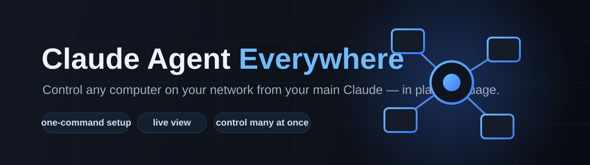

<p align="center">
  
</p>

<h1 align="center">🌐 CAE — Claude Agent Everywhere</h1>

<p align="center">
  <b>Turn any computer on your network into a Claude agent — controlled from your main PC, in plain language.</b>
</p>

<p align="center">
  
  
  
  
  
</p>

Install a tiny node on another computer with **one command** (it even installs
Python for you on a brand-new machine), pair it with a 6-digit code, and from
your main Claude you can say:

> "Claude, read the Gmail on **Omar Thinkpad** and summarize the unread ones."
> "On the **home-server**, update all packages and tell me when it's done."
> "Take a screenshot of **every** paired computer so I can see them all."

Claude does it on that machine and shows you a **live view**. Drive several
computers **at once** — great for servers and multitasking.

```
 Main PC (your Claude)                Controlled PC                 Server
 ┌────────────────────┐   Wi-Fi     ┌──────────────────┐     ┌──────────────┐
 │  CAE Hub (MCP)     │◄──────────► │  CAE Node        │     │  CAE Node    │
 │  lists devices     │  paired +   │  live screen     │     │  shell       │
 │  sends tasks       │  token auth │  mouse/keyboard  │     │  files       │
 │  shows live view   │             │  shell + banner  │     │              │
 └────────────────────┘             └──────────────────┘     └──────────────┘
```

---

## 1. On your main PC (the one with Claude) — just ask Claude

You don't run any commands yourself. Open Claude Code and **paste this prompt**:

```text
Install Claude Agent Everywhere on this computer and connect it to yourself:
clone https://github.com/omarperso/cae, run `pip install -r requirements.txt`
in it, then register the Hub with
`claude mcp add cae -- python <full path>/hub/cae_hub.py`. Then restart so you
can see the CAE tools.
```

Claude does the clone, the install and the wiring. After it restarts, it has
the CAE tools and can control your other computers.

## 2. On each computer you want to control — ONE command

This is the only place you paste a command, because a brand-new PC has no Claude
yet. It installs Python if missing, installs everything, opens a local page in
the browser, and shows a **6-digit pairing code**. Keep the window open.

**Windows — Command Prompt (cmd):**
```bat
curl -L https://raw.githubusercontent.com/omarperso/cae/main/install.ps1 -o "%TEMP%\cae.ps1" && powershell -ExecutionPolicy Bypass -File "%TEMP%\cae.ps1"
```

**Windows — PowerShell:**
```powershell
iwr -useb https://raw.githubusercontent.com/omarperso/cae/main/install.ps1 | iex
```

**Linux / macOS — terminal:**
```bash
curl -fsSL https://raw.githubusercontent.com/omarperso/cae/main/install.sh | bash -s -- "My Laptop"
```

> 💡 Tip: you can even ask your *main* Claude to generate this line for a given
> device, then run it on that device.

## 3. Then just talk to Claude

Everything after setup is plain language — no tools or commands to remember:

> **You:** What devices can I control?
> **Claude:** I see `Omar Thinkpad` (Windows) and `home-server` (Linux). Neither is paired.
> **You:** Pair the Thinkpad, the code is 418302.
> **Claude:** Paired. ✅
> **You:** Open its Gmail and tell me the unread subjects.
> **Claude:** *(takes control, screenshots, reads)* Here's what's on screen…
> **You:** Show me the Thinkpad live.
> **Claude:** Open this link to watch it: http://192.168.1.22:8765/stream

---

## Control one device

| Tool | Purpose |
|------|---------|
| `list_devices` / `paired_devices` | discover / list machines |
| `pair_device(name, code)` | pair once with the 6-digit code |
| `connect` / `disconnect` | take / release control (shows the banner) |
| `live_url` | watch the device live in a browser (video) |
| `screenshot` | let Claude see the screen (photo) |
| `click`, `type_text`, `press_keys` | drive the UI |
| `run_shell` | run commands (perfect for servers) |

## Control MANY devices at once (fleet / multitasking)

Ask for something and it runs on **all** paired computers in parallel, with
photo + video proof from each:

| Tool | Purpose |
|------|---------|
| `broadcast_connect(devices="all")` | take control of several machines; returns one **live URL per device** (video proof) |
| `broadcast_screenshot(devices="all")` | one **screenshot per device** (photo proof) |
| `broadcast_shell(cmd, devices="all")` | run the same command everywhere, get each machine's output |
| `broadcast_disconnect(devices="all")` | release them all |

`devices` is `"all"` (every paired machine) or a comma-separated list like
`"Omar Thinkpad, home-server"`.

> **You:** Update every machine and show me they all finished.
> **Claude:** *(broadcast_shell "sudo apt update && sudo apt -y upgrade")*
> `===== home-server =====` … `===== media-box =====` …
> *(broadcast_screenshot)* and here's a screenshot of each one. ✅

---

## Pairing & the 6-digit code — how it works

- **The code is single-use and short-lived.** It only exists to pair a device
  the first time. It's valid for ~2 minutes and dies the moment it's used —
  like an SMS login code.
- **Control is not time-limited.** Once paired, the Hub keeps a secret token
  (`~/.cae/hub.json`) and you control that device **as long as you want**, with
  no more codes, even across reboots.
- Need a new code (new device, or after un-pairing)? Press **Enter** in the
  node's terminal window to open a fresh pairing window.

## Safety — read this

CAE gives Claude real control of a computer, so it is consent-first:

- **Pairing required.** No machine accepts a command until you've typed its
  single-use 6-digit code.
- **Visible banner.** While a controller is connected, a red bar reads
  *"Claude is controlling this computer"* on the controlled machine.
- **Emergency stop.** Slam the mouse into the bottom-left corner of the
  controlled machine to cut control instantly; closing the node window also stops it.
- **Local network only.** Discovery and traffic stay on your LAN; nothing goes
  to an outside server.
- **Your logins stay yours.** Claude uses the browser already signed in on the
  remote machine — it never needs or sees your passwords.
- **Only your own devices.** Use CAE on computers you own or are authorized to administer.

## Roadmap

- TLS between Hub and Node (today: single-use pairing + token auth on LAN)
- Per-device permission profiles ("read-only", "no shell")
- A spawned Claude *on* each node, so devices work fully in parallel
- Mobile node (an old phone as a controllable screen)

## License

MIT
